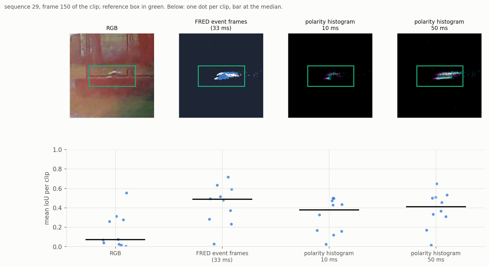
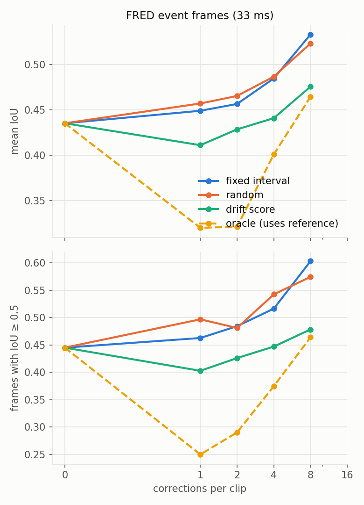
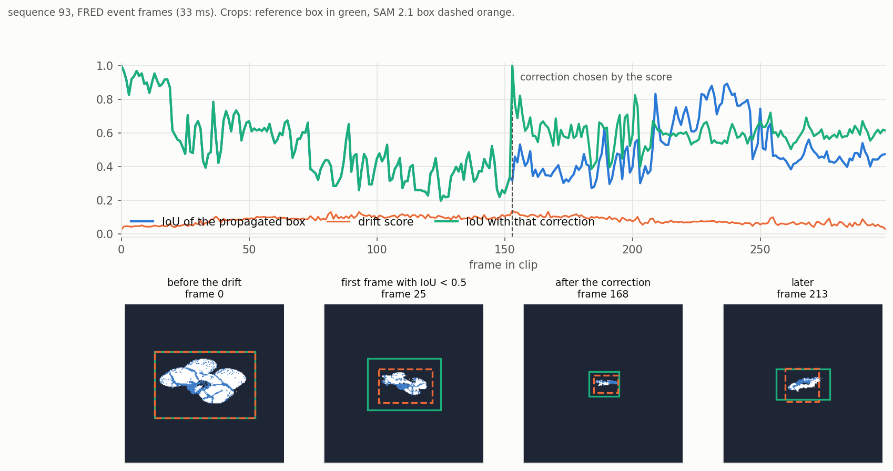

# Drone box propagation with SAM 2.1 on RGB and event-camera data

This repo tests SAM 2.1 as a box propagator for annotating drones on [FRED](https://arxiv.org/abs/2506.05163), a dataset recorded with a Prophesee EVK4 event camera next to a synchronised RGB camera. It measures three things:

- how well a single reference box on the first frame propagates on RGB frames compared with several event representations;
- whether per-frame signals computed during propagation flag the frames where the track has drifted;
- how a limited correction budget should be spent when a simulated annotator fixes boxes.

Everything runs as a DVC pipeline. The numbers below are read from the files in `results/`, produced by one run on a Kaggle machine with two T4 GPUs.

## Data and selection

FRED is read from its Hugging Face mirror, pinned to revision `980a8fa0`. Each sequence zip contains the RGB frames, the event frames extracted by Prophesee's frame generator at 30 FPS, the raw event stream as a Prophesee HDF5 file, and one box per frame and drone.

`boxprop.index` reads the central directory and the annotation file of the 231 zips through HTTP range requests, without downloading them, and records for each sequence the longest run of consecutive frames with exactly one annotated drone. A sequence is eligible when it never shows two drones at once, has no `_extra` folders, and its longest single-drone run covers at least 315 frames. That leaves 32 of the 47 test sequences. The selection keeps the first ten in numerical order, with at most three per drone model: Betafpv air75 (9, 12, 39), DarwinFPV cineape20 (20, 21, 29), DJI Mini 3 (93, 110, 111) and DJI Tello EDU (138). Each clip is 300 frames (10 s) and starts 15 frames into the run. The median box width per clip ranges from 30 to 63 pixels and the median height from 19 to 48, on a 1280 x 720 sensor.

## Event representations

The raw events are stored with Prophesee's ECF codec, which h5py, hdf5plugin and evlib could not decode here. `boxprop.ecf` is a NumPy/Numba port of the ECF decoder from [prophesee-ai/hdf5_ecf](https://github.com/prophesee-ai/hdf5_ecf) (Apache-2.0). It reads the compressed chunks directly with `read_direct_chunk` and uses the `CD/indexes` table, including its time offset, to decode only the chunks of a clip.

Four inputs are compared:

- `rgb`: the RGB frames;
- `evframe`: the event frames shipped with FRED;
- `hist10` and `hist50`: polarity histograms over 10 ms and 50 ms windows ending at each frame timestamp, rendered as ON, OFF and their maximum in three channels.

As a check of the decoder and of the timestamps, the active pixels of a 33.3 ms histogram are compared with the active pixels of the FRED event frame on 20 frames per clip. The mean IoU is 1.0 on seven clips, and the lowest single frame is 0.996 (`results/representations.csv`).

## Propagation and box calibration

SAM 2.1 tiny (`facebookresearch/sam2`, pinned commit) gets the reference box of the first frame as a prompt and propagates forward over the clip. A backward pass then starts from the last forward box. Backbone features are computed once per frame and cached, so later re-propagations only pay for memory attention and the mask decoder. The box is the bounding box of the largest connected component of the mask.

FRED boxes are drawn with a margin around the drone. A mask-tight box therefore scores a low IoU even when it sits exactly on the drone. On the first frame the propagation measures the scale and offset between the mask box and the reference box, and applies the same transform to every following box of that run. Only the box given to the tracker is used, and raw boxes are kept in the per-frame CSVs (`raw_x1`...).

Inference runs in fp16. On the first 100 frames of one clip, fp16 and fp32 boxes have a mean IoU of 0.984 with each other, and at least one frame where they differ completely (`results/precision_check.json`).

## Results

Mean IoU against the reference boxes over the 300 frames of each clip, with no correction, averaged over the 10 clips (`results/quality_by_representation.csv`):

| Input | Mean IoU | Median over clips | Frames with IoU ≥ 0.5 |
|---|---|---|---|
| RGB | 0.163 | 0.073 | 0.101 |
| FRED event frames (33 ms) | 0.435 | 0.488 | 0.445 |
| Polarity histogram, 10 ms | 0.314 | 0.379 | 0.270 |
| Polarity histogram, 50 ms | 0.385 | 0.411 | 0.345 |



RGB is the weakest input on nine clips out of ten. The exception is sequence 93, where RGB reaches 0.553 against 0.515 on event frames (`results/quality_per_clip.csv`). Sequence 111 is recorded at night, and on RGB SAM loses the drone within the first frames. Sequence 21 fails on every input, with mean IoU at or below 0.028. Among the inputs computed from raw events, the 50 ms window does better than the 10 ms one on nine clips out of ten. With 10 ms the drone often produces too few events, and the mask is empty on more than half of the frames of clips 12 and 21.

### Drift signals

For each frame of the event-frame propagation, `boxprop.drift` computes six signals:

- `fb`: 1 minus the IoU between the forward and backward boxes;
- `mask_conf`: 1 minus the IoU predicted by SAM's mask decoder;
- `obj_score`: 1 minus the sigmoid of SAM's object score;
- `jump`: the centre displacement relative to the previous box size;
- `size`: the log area change;
- `empty`: whether the mask is empty.

A frame counts as a failure when its IoU is below 0.5. That is 1665 of the 2990 frames after the first one. AUROC of each signal for separating failures from the other frames (`results/drift_auroc.csv`):

| Signal | AUROC |
|---|---|
| Mask decoder IoU (`mask_conf`) | 0.865 |
| Object score | 0.840 |
| Forward/backward disagreement | 0.608 |
| Empty mask | 0.575 |
| Size change | 0.555 |
| Position jump | 0.243 |
| Equal-weight combination | 0.682 |
| Logistic regression, leave one sequence out | 0.887 |

The two scores read from SAM itself carry most of the information. The position jump points the wrong way: frames with large jumps are more often correct than not. A likely reading is that once SAM has drifted onto background the box stays still, while a correctly tracked drone moves fast. The equal-weight combination was fixed before the run, and it is dragged down by that signal. A logistic regression trained on nine clips and tested on the tenth learns the sign and reaches 0.887.

### Correction budget

A simulated annotator gets N corrections per clip. A correction replaces the box by the reference box at the chosen frame, then SAM restarts from there until the next correction. Corrections are spaced by at least 10 frames. Four strategies choose the frames:

- **fixed**: evenly spaced;
- **random**: two seeds;
- **drift score**: the frames with the highest equal-weight score, chosen in one pass on the uncorrected run;
- **oracle**: the frames with the lowest true IoU, which uses the reference and is not available in practice.

Results on the event frames, mean IoU over the 10 clips (`results/simulation_summary.csv`):

| Corrections | Fixed | Random | Drift score | Oracle |
|---|---|---|---|---|
| 0 | 0.435 | 0.435 | 0.435 | 0.435 |
| 1 | 0.449 | 0.457 | 0.411 | 0.320 |
| 2 | 0.457 | 0.465 | 0.429 | 0.321 |
| 4 | 0.485 | 0.487 | 0.441 | 0.401 |
| 8 | 0.533 | 0.523 | 0.476 | 0.465 |



Guiding corrections by the drift score does worse than spacing them evenly, and choosing the worst frames with the reference does even worse. `boxprop.analyze` looks at the 30 frames that follow a single correction (`results/correction_effect.csv`). The fixed strategy corrects frame 150 on every clip. The 30 frames that follow it go from a mean IoU of 0.42 without correction to 0.51 with it. The score-guided correction lands on average at frame 206, on frames where the uncorrected IoU is 0.18. The 30 frames after it average 0.33, against 0.34 without the correction. The correction does not hold: on frames where SAM already struggles, it loses the drone again right after being reset. In this setting the budget is better spent on frames where the drone is still trackable than on the frames that are already wrong.

The equal-weight score was fixed before the run. After seeing the AUROC table, the simulation was rerun in a second job with the best single signal, `mask_conf`, as the review score (`boxprop.posthoc`). Because the signal was picked from these results, this is a post-hoc check. Fixed keyframes were rerun in the same job and give the same values as in the first run (`results/posthoc_summary.csv`):

| Corrections | Fixed | Mask decoder IoU |
|---|---|---|
| 0 | 0.435 | 0.435 |
| 1 | 0.449 | 0.414 |
| 2 | 0.457 | 0.423 |
| 4 | 0.485 | 0.423 |
| 8 | 0.533 | 0.454 |

A better failure detector does not give a better review policy. Choosing by mask confidence stays below fixed spacing at every budget, and below no correction at all up to four corrections. Finding the frames where the track is wrong and finding the frames where a correction will hold are two different problems.



### Cost

On one T4, encoding 300 frames takes 17.1 s on average and one forward pass 29.3 s, about 0.1 s per frame. The correction simulation of one clip, all strategies and budgets together, re-propagates between 2504 and 3204 frames and takes between 235 and 301 s (`results/timing.csv`).

## Reproducing

```bash
pip install -e ".[sam2,dev]"
dvc repro
dvc metrics show
```

`dvc.yaml` chains `index`, `select`, `fetch`, `represent`, `propagate`, `report`, `analyze` and `posthoc`. The parameters live in `params.yaml`, and `dvc.lock` records the hashes of every input and output of the runs reported here. The `posthoc` stage ran in a second Kaggle job, where the regenerated clips and representations had the same hashes as in the first. The clips, raw events and rendered representations are regenerated from the pinned Hugging Face revision, so they are not pushed to a DVC remote. The `propagate` stage needs a GPU and uses all visible GPUs, one process per GPU.

`notebooks/kaggle_pipeline.ipynb` runs the same pipeline on a Kaggle GPU notebook with internet enabled. The tests run on synthetic data and cover box utilities, the ECF decoder on hand-built buffers, box calibration, keyframe selection and the segment logic of the correction simulation:

```bash
pytest
```

## Limitations

- Ten clips of 300 frames from the test split. The per-clip spread is large (the RGB clip means range from 0.003 to 0.553), so differences of a few hundredths between strategies are not meaningful.
- The reference boxes were produced by FRED's own semi-automatic pipeline on event frames, then checked by hand. This favours the event frames over RGB, and over histograms whose extent differs from the 33 ms frames.
- The calibration assumes the margin between the drone and its box stays proportional over a clip. A poor mask on the prompt frame propagates its error to the whole run.
- The drift score weights were chosen before the run and were not tuned. Mask confidence alone was tried afterwards as a review score; the learned combination was not simulated.
- Only SAM 2.1 tiny was run. ETAP, a trained detector, video reconstruction (E2VID) and fine-tuning SAM on events are left for later work.

## Data

Magrini G, Marini N, Becattini F, Berlincioni L, Biondi N, Pala P, Del Bimbo A. FRED: The Florence RGB-Event Drone Dataset. *ACM International Conference on Multimedia*, 2025. Licensed Apache-2.0.
